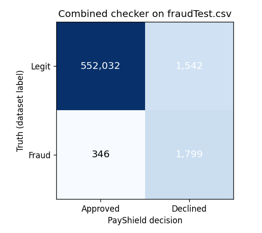

# PayShield evaluation

<!-- FRAUD_EVAL_START -->
## Fraud checker on the test set

Test file: `fraudTest.csv` — **555,719 payments, 2,145 fraud (base rate 0.386%)**.

| Approach | Precision | Recall | F1 | PR-AUC | False positive rate | TP | FP | FN |
|---|---|---|---|---|---|---|---|---|
| Rules only (any rule fires) | 0.047 | 0.467 | 0.085 | 0.038 | 3.6819% | 1,001 | 20,382 | 1,144 |
| ML only (score ≥ 98) | 0.781 | 0.765 | 0.772 | 0.848 | 0.0833% | 1,640 | 461 | 505 |
| Combined (score ≥ 48.5) | 0.538 | 0.839 | 0.656 | 0.611 | 0.2786% | 1,799 | 1,542 | 346 |

TP = fraud caught, FP = good payments wrongly declined, FN = fraud missed.
Thresholds were chosen on the validation set (last 10% of training dates), not on this test set.

### How often each rule fires

| Rule | Fired | Of which fraud | Precision |
|---|---|---|---|
| `too_fast` | 0 | 0 | — |
| `unusual_amount` | 7,465 | 910 | 0.122 |
| `impossible_travel` | 14,176 | 190 | 0.013 |

## Limitations

- **Simulated data.** Sparkov is generated by a simulator, not real card traffic. It is widely
  used for teaching and benchmarking, but real fraud is messier and changes over time.
- **No live traffic.** Every number here comes from replaying the dataset offline. Live
  payments in the demo use the current time, so time-based features behave differently.
- **Rules were not tuned to this data.** The three rules use fixed, common-sense limits.
  They are there to be explainable, not to maximise F1.
- **One threshold for everything.** A real issuer would tune it per merchant type and weigh
  the cost of a missed fraud against the cost of annoying a good customer.

<!-- FRAUD_EVAL_END -->
